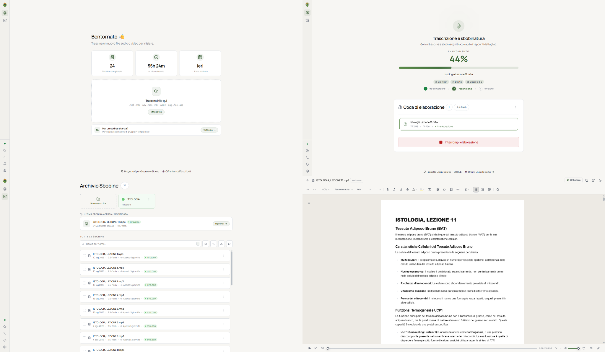

# El Sbobinator

Applicazione desktop per trasformare lezioni audio e video in dispense di studio tramite Google Gemini.

<p align="center">
  <a href="https://github.com/vimuw/El-Sbobinator/releases/latest"></a>
  <a href="https://github.com/vimuw/El-Sbobinator/actions/workflows/build.yml"></a>
  <a href="https://codecov.io/gh/vimuw/El-Sbobinator"></a>
  <a href="https://github.com/vimuw/El-Sbobinator/releases"></a>
  <a href="LICENSE"></a>
</p>

<p align="center">
  
</p>

---

## Funzioni Principali

- **Trascrizione e Rielaborazione**: Converte registrazioni audio e video in dispense di studio strutturate, ripulendo il parlato da intercalari e ripetizioni e organizzando i contenuti in capitoli, paragrafi ed elenchi puntati.
- **Gratuita e con chiave personale**: Nessun abbonamento all'app; utilizzi Google Gemini con la tua API key.
- **Editor Sincronizzato**: Permette di riascoltare la lezione con il player audio sincronizzato (velocità da 1.0x a 3.0x) mentre si corregge la bozza, con supporto per formule scientifiche (LaTeX) e copia rapida formattata per altri editor di documenti.
- **Archivio Locale & Ricerca Istantanea**: Conserva lo storico delle lezioni elaborate sul computer in cartelle organizzabili, con ricerca testuale full-text ad alta velocità tra tutte le sbobine salvate.

---

## Download e Installazione

Scarica la versione per il tuo sistema operativo:

| Sistema Operativo | Pacchetto | Installazione rapida |
| :--- | :--- | :--- |
| **Windows** | [**Scarica per Windows (.exe)**](https://github.com/vimuw/El-Sbobinator/releases/latest) | Avvia l'installer `.exe` e segui la procedura guidata. |
| **macOS** | [**Scarica per macOS (.dmg)**](https://github.com/vimuw/El-Sbobinator/releases/latest) | Apri il file `.dmg` e trascina *El Sbobinator* in **Applicazioni**. |

> [!NOTE]
> L'applicazione verifica automaticamente la presenza di aggiornamenti all'avvio e notifica la disponibilità di nuove versioni.

---

## Guida Rapida

Inizia a sbobinare in 4 passaggi:

### 1. Ottieni la tua chiave Google Gemini

1. Accedi a [**aistudio.google.com/apikey**](https://aistudio.google.com/apikey) con il tuo account Google.
2. Clicca su **"Create API key"** (oppure *"Get API key"*), seleziona o crea un progetto Google Cloud e conferma.
3. Copia la chiave generata (`AIzaSy...`).

### 2. Inserisci la chiave nell'applicazione
All'avvio di **El Sbobinator**, incolla la chiave nel campo iniziale e clicca su **Salva e inizia**. La chiave viene memorizzata in modo protetto nel portachiavi sicuro del sistema operativo (Windows DPAPI o macOS Keychain).

> [!NOTE]
> **Costi e quote Google**: Disponibilità dei modelli, eventuali costi e limiti dipendono dal piano del **progetto Google Cloud** dell'utente. Se raggiungi un limite al minuto, l'app attende e riprova. Se esaurisci la quota giornaliera, può continuare con una chiave di riserva che abbia quota disponibile; altrimenti occorre attendere il ripristino a mezzanotte Pacific Time. Consulta le [quote Gemini API](https://ai.google.dev/gemini-api/docs/rate-limits).

### 3. Trascina la registrazione e avvia
Trascina il file audio o video direttamente nella finestra dell'applicazione (è possibile inserire più registrazioni in coda) e clicca su **Avvia Sbobinatura**.
- **Formati audio supportati**: `.m4a`, `.mp3`, `.wav`, `.aac`, `.flac`, `.ogg`, `.opus`.
- **Formati video supportati**: `.mp4`, `.mkv`, `.webm`, `.mov`, `.3gp`.

### 4. Rivedi ed esporta
Al termine dell'elaborazione puoi aprire la lezione nell'editor per riascoltare l'audio e correggere il testo. Usa **Copia documento** per incollarla con la formattazione in un altro editor.

---

## Risoluzione Problemi Comuni

### Avviso SmartScreen su Windows ("PC protetto da Windows")
Windows può mostrare questo avviso quando l'app scaricata non è ancora riconosciuta come affidabile. Se hai scaricato El Sbobinator dalla pagina ufficiale delle release:
1. Nella schermata blu, cliccare su **Ulteriori informazioni**.
2. Cliccare sul pulsante **Esegui comunque**.

### Schermata bianca o vuota all'avvio su Windows
Se la finestra resta vuota, verifica che [WebView2 Runtime](https://go.microsoft.com/fwlink/p/?LinkId=2124703) sia installato; se manca, installalo e riavvia l'app. Il componente è preinstallato su Windows 11 e presente sulla maggior parte dei dispositivi Windows 10.

### Avviso sviluppatore non verificato su macOS (Gatekeeper)
macOS può bloccare un'app se non ne riconosce lo sviluppatore o se manca la notarizzazione. Se hai scaricato El Sbobinator dalla pagina ufficiale delle release, segui la procedura per il messaggio visualizzato:

- **Sviluppatore non verificato o app non verificabile**:
  1. Aprire **Impostazioni di Sistema** → **Privacy e Sicurezza**.
  2. Scorrere in basso fino alla sezione **Sicurezza**.
  3. In corrispondenza dell'avviso di blocco per *El Sbobinator*, cliccare su **Apri comunque** e confermare con la propria password o Touch ID.
- **Se macOS mostra "App danneggiata" (rimozione quarantena)**:
  Il messaggio può indicare anche file alterati o incompleti: prima scarica nuovamente il pacchetto dalla pagina ufficiale delle release. Se il pacchetto integro resta bloccato dalla quarantena, apri il **Terminale** ed esegui:
  ```bash
  xattr -cr "/Applications/El Sbobinator.app"
  ```
- **Metodo rapido alternativo (versioni precedenti)**:
  Nella cartella **Applicazioni**, fare clic destro (o `Control` + clic) su *El Sbobinator* e selezionare **Apri**, quindi confermare nella finestra di dialogo.

---

## 🐛 Hai trovato un bug?

> [**Segnala un problema →**](https://docs.google.com/forms/d/e/1FAIpQLSdzfLau1SrSZuJgQ2J3lERgtXcz9EjE_vP63nHkiVYCsRqMzA/viewform)

---

## Privacy e Architettura dei Dati

- **Client Desktop Locale**: L'applicazione viene eseguita sul computer dell'utente e conserva file e bozze localmente. I contenuti necessari all'elaborazione AI vengono trasmessi direttamente e in forma cifrata agli endpoint ufficiali di Google Gemini (`generativelanguage.googleapis.com`) tramite la credenziale dell'utente. File audio, trascrizioni e API key non vengono inviati a infrastrutture gestite dallo sviluppatore.
- **Dati inviati a Google**: Il trattamento di audio e testi trasmessi a Gemini dipende dal piano e dalle policy Google. Consulta i [Termini Aggiuntivi Gemini API](https://ai.google.dev/gemini-api/terms).

---

## Note Legali e Responsabilità d'Uso

El Sbobinator è pensato per l'utilizzo personale a fini di studio. L'utente è responsabile del rispetto della normativa applicabile, dei regolamenti del proprio ateneo e della tutela dei dati personali.

Per i termini completi, le condizioni vincolanti e l'esclusione di responsabilità, consultare il documento [**DISCLAIMER.md**](DISCLAIMER.md).

---

## Licenza

Distribuito con licenza **MIT**. Per i dettagli completi, consultare il file [`LICENSE`](LICENSE).
