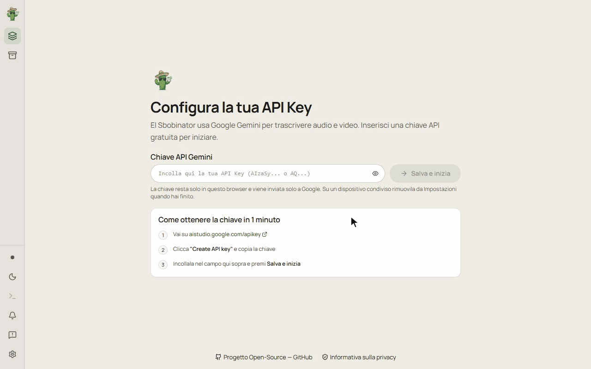

# El Sbobinator

<p align="center">
  <a href="https://elsbobinator.com"></a>
  <a href="https://github.com/vimuw/El-Sbobinator/releases/tag/v2.7.3"></a>
  <a href="LICENSE"></a>
</p>

App web gratuita che trasforma lezioni audio e video in dispense di studio tramite Google Gemini. Si usa dal browser, su computer, tablet e telefono, senza installare niente.

<p align="center">
  
</p>

---

## Come usarlo

> [!TIP]
> ### [**Apri El Sbobinator → elsbobinator.com**](https://elsbobinator.com)
> È la versione **mantenuta**: riceve aggiornamenti e correzioni. Funziona dal browser su computer, tablet e telefono, senza installare nulla, e si aggiorna da sola.

**Requisiti**: un browser aggiornato (Chrome, Edge o Safari), una connessione a internet e una chiave API Google Gemini personale (vedi [Guida Rapida](#guida-rapida)).

> [!NOTE]
> **Versione desktop 2.7.3 (riserva)**: usala solo se la versione web ti dà problemi. Non riceve più aggiornamenti.
> Scarica per [**Windows (.exe)**](https://github.com/vimuw/El-Sbobinator/releases/download/v2.7.3/El-Sbobinator-Setup-v2.7.3.exe) · [**macOS (.dmg)**](https://github.com/vimuw/El-Sbobinator/releases/download/v2.7.3/El-Sbobinator-v2.7.3.dmg) · dettagli in [Versione desktop (riserva)](#versione-desktop-riserva).

---

## Funzioni Principali

- **Trascrizione e Rielaborazione**: Converte registrazioni audio e video in dispense di studio strutturate, ripulendo il parlato da intercalari e ripetizioni e organizzando i contenuti in capitoli, paragrafi ed elenchi puntati.
- **Gratuita e con chiave personale**: Nessun abbonamento e nessun account; utilizzi Google Gemini con la tua API key.
- **Editor con audio sincronizzato**: Riascolti la lezione con il player (velocità da 0,5x a 3x) mentre correggi la bozza, con supporto per formule scientifiche (LaTeX). Puoi copiare il documento con la formattazione oppure scaricarlo in formato **.docx**.
- **Archivio e Ricerca**: Le sbobine restano nel tuo browser, organizzate in raccolte, con ricerca nel testo di tutte le lezioni. Puoi scaricarne un backup in qualsiasi momento.
- **Salvataggio su Google Drive**: Se vuoi, salvi le sbobine sul tuo Google Drive e le ritrovi sincronizzate su tutti i tuoi dispositivi: computer, tablet e telefono.

---

## Guida Rapida

Inizia a sbobinare in 4 passaggi:

### 1. Ottieni la tua chiave Google Gemini

1. Accedi a [**aistudio.google.com/apikey**](https://aistudio.google.com/apikey) con il tuo account Google.
2. Clicca su **"Create API key"** (oppure *"Get API key"*), seleziona o crea un progetto Google Cloud e conferma.
3. Copia la chiave generata (`AIzaSy...`).

### 2. Inserisci la chiave
Apri [**elsbobinator.com**](https://elsbobinator.com), incolla la chiave nel campo iniziale e clicca su **Salva e inizia**. La chiave resta salvata in questo browser, non cifrata: chi usa il tuo dispositivo con lo stesso browser può vederla.

> [!NOTE]
> **Costi e quote Google**: modelli disponibili, costi e limiti dipendono dal piano del tuo **progetto Google Cloud**. Se raggiungi un limite al minuto, l'app attende e riprova da sola; se esaurisci la quota giornaliera, puoi usare una chiave di riserva oppure attendere il ripristino a mezzanotte (ora del Pacifico). Dettagli nelle [quote Gemini API](https://ai.google.dev/gemini-api/docs/rate-limits).

### 3. Scegli la registrazione e avvia
Trascina il file nella pagina oppure sceglilo dal dispositivo (puoi mettere più registrazioni in coda) e clicca su **Avvia sbobinatura**.
- **Formati supportati**: `.mp3`, `.m4a` (audio) e `.mp4` (video).

### 4. Rivedi ed esporta
Al termine dell'elaborazione apri la lezione nell'editor per riascoltare l'audio e correggere il testo. Usa **Copia documento** per incollarla con la formattazione in un altro editor, oppure **Scarica .docx**: da iPad, telefono o Safari è il modo per portare anche le immagini in Google Docs.

> [!IMPORTANT]
> Le sbobine sono salvate nella memoria del browser: se il browser la svuota le perdi, e su un altro dispositivo non le ritrovi. Ogni tanto scarica un backup (Impostazioni → **Archiviazione**) oppure attiva la sincronizzazione in Impostazioni → **Google Drive**.

---

## Privacy e Architettura dei Dati

- **Nel tuo browser**: Sbobine, raccolte, chiavi API e (se scegli di tenerlo) l'audio delle lezioni restano nella memoria del browser. Non serve un account e lo sviluppatore non riceve né le sbobine, né l'audio, né le chiavi.
- **Google Gemini**: Per trascrivere, il browser invia l'audio e i testi direttamente e in forma cifrata agli endpoint ufficiali di Google Gemini (`generativelanguage.googleapis.com`) con la tua chiave. Nello Spazio Economico Europeo (Italia compresa), in Svizzera e nel Regno Unito Google applica anche alle chiavi gratuite le regole del livello a pagamento: non usa i contenuti per migliorare i suoi prodotti. Consulta i [Termini Aggiuntivi Gemini API](https://ai.google.dev/gemini-api/terms).
- **Google Drive (facoltativo)**: Se attivi la sincronizzazione, le sbobine vanno dal browser a una cartella nascosta del tuo Drive. Audio e chiavi non vengono sincronizzati.
- **Segnalazioni ed errori**: Allo sviluppatore arrivano quello che mandi con "Segnala un problema" o per email e i report automatici degli errori (senza i testi delle sbobine), che puoi spegnere in Impostazioni → Assistenza.

Tutti i dettagli sono nell'[**informativa sulla privacy**](https://elsbobinator.com/privacy).

---

## Versione desktop (riserva)

La versione desktop **2.7.3** per Windows e macOS resta disponibile come riserva, da usare solo se la versione web ti dà problemi. Non riceve più aggiornamenti. Su Mac consigliamo la versione web, perché l'app desktop dà ancora problemi su alcuni sistemi macOS.

| Sistema Operativo | Pacchetto | Installazione |
| :--- | :--- | :--- |
| **Windows 10/11** | [**El-Sbobinator-Setup-v2.7.3.exe**](https://github.com/vimuw/El-Sbobinator/releases/download/v2.7.3/El-Sbobinator-Setup-v2.7.3.exe) | Avvia l'installer e segui la procedura guidata. |
| **macOS** | [**El-Sbobinator-v2.7.3.dmg**](https://github.com/vimuw/El-Sbobinator/releases/download/v2.7.3/El-Sbobinator-v2.7.3.dmg) | Apri il file `.dmg` e trascina *El Sbobinator* in **Applicazioni**. |

È un'app separata dal sito: le sbobine fatte con una versione non compaiono nell'altra. Il codice sorgente della versione desktop è nella branch [`desktop-2.7`](https://github.com/vimuw/El-Sbobinator/tree/desktop-2.7).

<details>
<summary><strong>Windows: avviso SmartScreen ("PC protetto da Windows")</strong></summary>

Windows può mostrare questo avviso quando l'app scaricata non è ancora riconosciuta come affidabile. Se hai scaricato El Sbobinator dalla pagina ufficiale delle release:
1. Nella schermata blu, clicca su **Ulteriori informazioni**.
2. Clicca sul pulsante **Esegui comunque**.

</details>

<details>
<summary><strong>Windows: schermata bianca o vuota all'avvio</strong></summary>

Verifica che [WebView2 Runtime](https://go.microsoft.com/fwlink/p/?LinkId=2124703) sia installato; se manca, installalo e riavvia l'app. Il componente è preinstallato su Windows 11 e presente sulla maggior parte dei dispositivi Windows 10.

</details>

<details>
<summary><strong>macOS: sviluppatore non verificato o app non verificabile</strong></summary>

Se hai scaricato El Sbobinator dalla pagina ufficiale delle release:
1. Apri **Impostazioni di Sistema** → **Privacy e Sicurezza**.
2. Scorri in basso fino alla sezione **Sicurezza**.
3. Accanto all'avviso di blocco per *El Sbobinator*, clicca su **Apri comunque** e conferma con la password o Touch ID.

</details>

<details>
<summary><strong>macOS: "App danneggiata"</strong></summary>

Il messaggio può indicare file alterati o incompleti: prima scarica di nuovo il pacchetto dalla pagina ufficiale delle release. Se il pacchetto integro resta bloccato dalla quarantena, apri il **Terminale** ed esegui:

```bash
xattr -cr "/Applications/El Sbobinator.app"
```

</details>

---

## Note Legali e Responsabilità d'Uso

El Sbobinator è pensato per l'utilizzo personale a fini di studio da parte di utenti maggiorenni, come richiesto dai termini dell'API Gemini. L'utente è responsabile del rispetto della normativa applicabile, dei regolamenti del proprio ateneo e della tutela dei dati personali.

Per i termini completi, le condizioni vincolanti e l'esclusione di responsabilità, consultare il documento [**DISCLAIMER.md**](DISCLAIMER.md).

---

## Licenza

Distribuito con licenza **MIT**. Per i dettagli completi, consultare il file [`LICENSE`](LICENSE).
